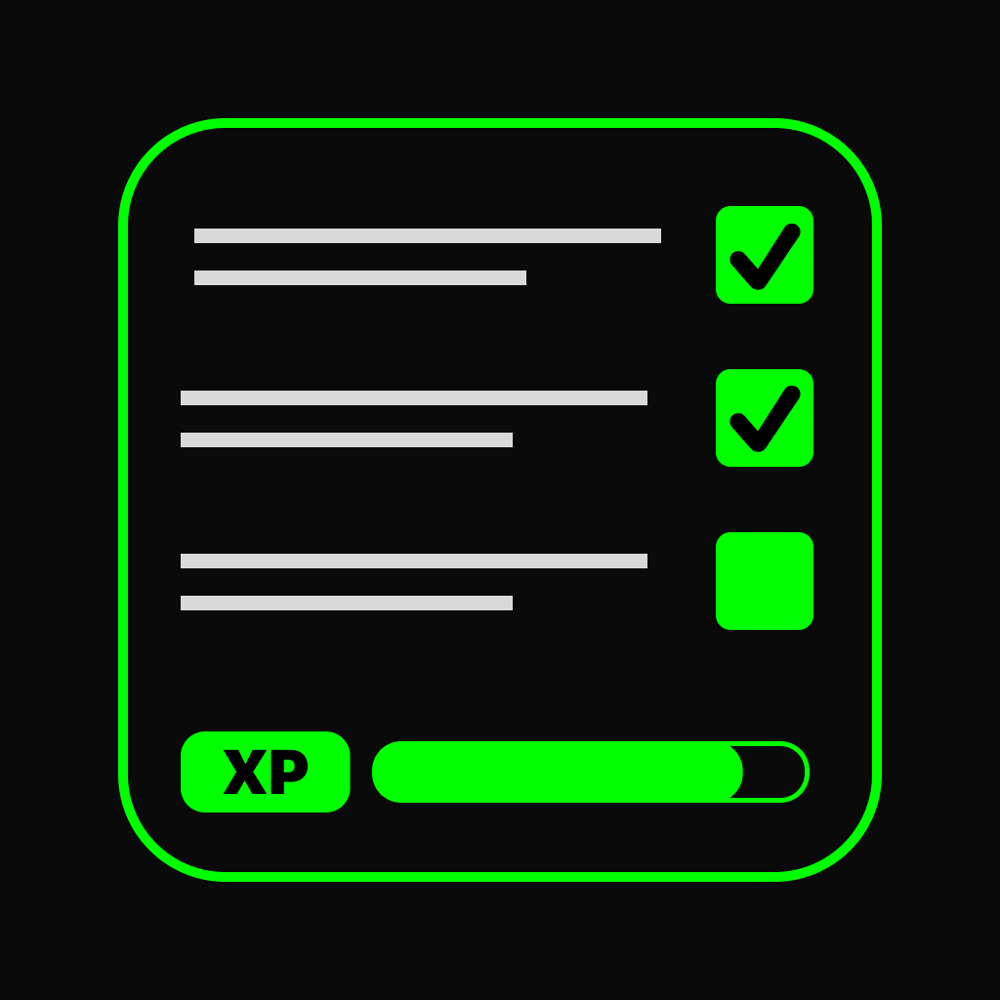

<div align="center">



# CyberDo

### Your routine, in RPG mode. 🕹️

CyberDo is a gamified to-do list with a cyberpunk look. Every task is a **quest** tied to
an RPG attribute: finish quests and goals to earn XP, level up your character, grow your
attributes, keep your streak alive and unlock achievements — all in a native SwiftUI app.

<br/>

[](https://apps.apple.com/br/app/cyberdo/id6749083212)
[](https://www.apple.com/ios/)
[](https://swift.org)
[](https://developer.apple.com/xcode/swiftui/)
[](https://developer.apple.com/documentation/coredata)

</div>

---

## 📑 Table of Contents

- [About](#-about)
- [Features](#-features)
- [How It Works](#-how-it-works)
- [Tech Stack](#-tech-stack)
- [Project Structure](#-project-structure)
- [Getting Started](#-getting-started)
- [Authors](#-authors)

---

## 📖 About

Traditional to-do lists work, but they're rarely fun. CyberDo turns your routine into an
RPG: a finished task stops being just a checkmark and becomes XP for your character.

Each quest trains one of eight attributes — **Strength, Dexterity, Vitality, Vigor,
Endurance, Intelligence, Faith** and **Attunement** — so your character sheet shows which
side of your life you've been working on. The neon, monospaced cyberpunk identity keeps
it far from the generic productivity-app look.

CyberDo is **live on the App Store** — [download it here](https://apps.apple.com/br/app/cyberdo/id6749083212).

---

## 🚀 Features

- **⚔️ Quests** — tasks with a frequency (daily, weekly or monthly), an attribute and a priority (**Main** or **Side** quest).
- **🎯 Goals** — longer-term goals with a target and progress, worth more XP than a single quest.
- **⭐ XP & levels** — quests and goals fill your XP bar; reach the cap to level up, and each new level raises the XP needed for the next.
- **🧬 Attributes** — leveling up grows the attributes of the quests you completed.
- **🔥 Streak multiplier** — complete all your quests on consecutive days to grow a multiplier applied to every XP you earn.
- **🏅 Achievements** — a catalog of achievements, loaded from the web, with progress toward each one.
- **🔔 Reminders** — local notifications nudge you to come back to your quests.
- **🌃 Cyberpunk identity** — custom SF Mono typography and a neon color palette.

---

## ⚙️ How It Works

1. **Create a quest** and choose its frequency, attribute and priority.
2. **Complete quests and goals** — each quest is worth 50 XP and each goal 100 XP, multiplied by your current streak.
3. **Level up** — when the XP bar is full you gain a level, and the attributes of your completed quests go up.
4. **Keep the streak** — finishing every quest on consecutive days increases the multiplier.
5. **Unlock achievements** and follow your progress on the profile.

Under the hood, the `User`, quest (`ToDo`) and goal (`Metas`) entities live in Core Data,
linked by relationships and managed by a single `CoreDataController`. `UserModel` owns
the game rules (XP, levels, attributes and streak), the achievements catalog is decoded
from remote JSON with `Codable` and `async/await`, and reminders are scheduled with
`UserNotifications`.

---

## 🛠️ Tech Stack

| Area | Tech |
|------|------|
| UI | SwiftUI |
| Persistence | Core Data (with relationships) |
| Networking | URLSession (async/await) · Codable |
| Notifications | UserNotifications |
| Typography | SF Mono (custom fonts) |
| Architecture | MVVM |

---

## 📂 Project Structure

```
CyberDo/CyberDo/
├── CyberDoApp.swift      # App entry
├── HomeView/             # Quest list, calendar and quest creation
├── ProfileView/          # Level, XP bar, attributes, goals, streak and progress chart
├── AchievementView/      # Achievements catalog and progress
├── Models/               # CoreDataController, UserModel (game rules), goals, notifications, JSON
├── Font/                 # SF Mono font files
└── Assets.xcassets/      # Neon color palette, icons
```

---

## 🎯 Getting Started

### Requirements

- Xcode 16+
- iOS 17.6+

### Run

```bash
git clone https://github.com/JonasFNMelo/CyberDo.git
cd CyberDo
open CyberDo/CyberDo.xcodeproj
```

Then pick an iPhone simulator and run (`⌘R`).

---

## 👥 Authors

<table width="100%">
  <tr>
    <td align="center" width="100%">
      <a href="https://github.com/JonasFNMelo"></a>
      <br/><sub><b>Jonas Melo</b></sub><br/>
      <a href="https://github.com/JonasFNMelo"></a>
      <a href="https://www.linkedin.com/in/jonas-melo-/"></a>
    </td>
  </tr>
</table>
